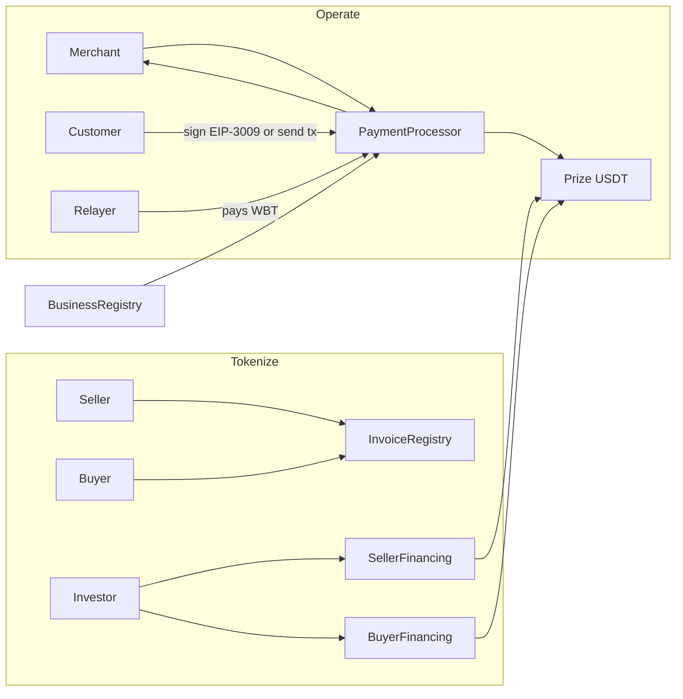

# WhiteFinance

Business finance on [Whitechain](https://whitechain.io): stablecoin checkout, invoice financing, and gasless USDT payments.

**Status: architecture complete. Implementation has not started. Waiting for approval of the design and the open decisions below.**

This repository currently contains documentation only. There is no Solidity, no Next.js app, no relayer, and no deployment.

## What it is, in simple language

WhiteFinance is a testnet product for businesses that want to use USDT on Whitechain.

1. **Operate** — A merchant creates a payment link. A customer opens a hosted checkout and pays in USDT. The merchant sees the payment, can refund all or part of it, and can plug the same checkout into a demo store with a small SDK. This is not a button that just calls `transfer`.
2. **Tokenize** — A seller issues an invoice. The buyer confirms it. Either an investor buys the receivable at a discount (factoring), or an investor pays part of the invoice for the buyer (buyer financing). Those two workflows are separate so money is not counted twice.
3. **Scale** — At checkout, the customer can sign an exact USDT authorization (EIP-3009) instead of sending a transaction. A relayer pays WBT gas. The customer still has to approve the precise token, amount, recipient, nonce, and time window. Unsigned payments are impossible.

All qualifying payments use the official prize USDT, not USDT.e and not a token we mint.

## Why this needs onchain USDT on Whitechain

A card rail or a custodial “pay in stablecoins” API records a balance in someone’s database. WhiteFinance records the payment, the refund, and the financing assignment as USDT movements and events on Whitechain, where the merchant, buyer, and investor can independently check the same explorer link. Settlement is the token transfer itself, not a promise to settle later. Whitechain is an EVM OP Stack L2 with 1-second blocks and WBT gas, so a hosted checkout and a gasless relayer can run with ordinary Ethereum tooling while still using the prize USDT that this network’s business track requires.

A regular payment rail cannot give the investor an onchain, exclusive repayment destination for a confirmed invoice, and it cannot let a customer push USDT with a signature while a merchant-side relayer pays gas — both of which this design does.

## Architecture documents

| Document | Contents |
| --- | --- |
| [docs/architecture.md](docs/architecture.md) | System design, contracts, backend, frontend, risks |
| [docs/business-logic.md](docs/business-logic.md) | Journeys, accounting, state machines, legal vs technical |
| [docs/security-model.md](docs/security-model.md) | Roles, invariants, relayer threats, tests |
| [docs/api-specification.md](docs/api-specification.md) | APIs, relayer, webhooks, env vars |
| [docs/frontend-specification.md](docs/frontend-specification.md) | Pages, states, UI rules |
| [docs/development-roadmap.md](docs/development-roadmap.md) | Exact implementation order |
| [docs/whitechain-compatibility.md](docs/whitechain-compatibility.md) | What was verified onchain and in official docs |

## Network

| Parameter | Value |
| --- | --- |
| Network | Whitechain Sepolia |
| Chain ID | `1874` |
| RPC | https://rpc.testnet.whitechain.io |
| Explorer | https://explorer.testnet.whitechain.io/ |
| Faucet (WBT only) | https://faucet.testnet.whitechain.io/ |
| Gas token | WBT |
| Prize USDT | `0xcedfB56113143d55b2358b8CFbB0dEB5Ad2f55a7` |
| Token | Tether USD / `USDT` / 6 decimals |
| Do not use | Token-list USDT.e `0xaa7962d073935D387e8d442DA1D7149C81388f46` |

Independently verified on 6 November 2026: chain id, RPC, prize token name/symbol/decimals, EIP-3009 ABI and verified source (`transferWithAuthorization`, `receiveWithAuthorization`), and EIP-712 `DOMAIN_SEPARATOR`. Details and limits: [docs/whitechain-compatibility.md](docs/whitechain-compatibility.md).

A live gasless payment was **not** executed. `safe` / `finalized` RPC tags were **not** probed. There is **no verified prize-USDT faucet** in official docs (the public faucet drips WBT).

## Architecture snapshot

### Contracts (proposed)

| Contract | Job |
| --- | --- |
| `BusinessRegistry` | Public business profiles, roles, payout address, optional webhook URL |
| `PaymentProcessor` | Intents, settlement, receipts, refunds, gasless settle |
| `InvoiceRegistry` | Invoice facts, hashes, buyer confirmation, uniqueness |
| `SellerFinancing` | Factoring lifecycle |
| `BuyerFinancing` | Buyer-side financing lifecycle |
| `EscrowVault` | **Omit in v1** (pending approval) |
| `TransferPolicy` | **Omit in v1** (pending approval) |

### Backend

Next.js route handlers read the chain. A **separate** relayer worker holds the gas key, validates authorizations, and submits `settleWithAuthorization`. No database. Webhooks are best-effort; the chain is the source of truth. An in-memory retry list is not a durable queue.

### Frontend

One App Router app: merchant, customer checkout, seller, buyer, investor, admin, plus a demo store that uses the SDK. Dark terminal-inspired UI, orange accent. Reown AppKit on Whitechain Sepolia with email/social login disabled (embedded wallets do not work here).

## Transaction flows

**Checkout (gasful):** merchant creates intent onchain → customer `approve` + `pay` → USDT goes to merchant payout → `PaymentSettled`.

**Checkout (gasless):** same intent → customer signs `ReceiveWithAuthorization` to the processor → relayer submits → processor forwards USDT to merchant → `PaymentSettled`. Customer needs USDT, not WBT.

**Refund:** merchant sends USDT back through the processor, full or partial, never more than paid.

**Seller factoring:** invoice 100,000 confirmed → investor sends 95,000 to seller → later buyer pays 100,000 to investor through the contract.

**Buyer financing:** invoice 100,000 confirmed → investor sends 30,000 to seller → buyer still owes seller 70,000 and owes investor 30,000 + fee. The 30,000 is not owed twice.

Financing fund and repay require WBT in v1.

## Security assumptions (short)

- Customers must sign exact payments.
- Admin can pause, not siphon USDT.
- Prize USDT issuer can block or upgrade the token.
- Relayer can be stolen for WBT only, not for customer USDT without a signature.
- Soft confirmations are not final.
- Invoice hashes are not authenticity; buyer confirmation is required; legal assignment lives offchain.
- No protocol proxies in v1 (proposed).

Full model: [docs/security-model.md](docs/security-model.md).

## Unresolved decisions — approval needed

Do not implement until these are accepted or replaced.

1. **Omit `EscrowVault` and `TransferPolicy` in v1?** Proposal: yes.
2. **Seller factoring and buyer financing mutually exclusive on one invoice?** Proposal: yes.
3. **Payment intents fully onchain** (merchant pays WBT to create) vs signed offchain blobs? Proposal: onchain.
4. **Webhook URLs public onchain**, delivery best-effort, poll is source of truth? Proposal: yes.
5. **Platform fee?** Proposal: 0.
6. **Late interest?** Proposal: none.
7. **Grace period before `DEFAULTED`?** Proposal: 14 days, permissionless mark.
8. **Who requests buyer financing?** Proposal: buyer only.
9. **Who may invest?** Proposal: any registered investor (open allowlist).
10. **Seller factoring full face only, or partial?** Proposal: full face in v1 (`advance + discount == face`).
11. **Buyer financing fee:** fixed USDT amount vs percent? Proposal: fixed amount set at request.
12. **Dispute resolver?** Proposal: either named party can flag; admin can clear the flag; no clawback of funded USDT.
13. **`settleWithAuthorization` permissionless** (relayer is convenience) vs `RELAYER_ROLE`? Proposal: permissionless.
14. **Refunds merchant-funded** (not escrowed captures)? Proposal: yes.
15. **UI “Paid” at 1 L2 block (soft)** with stage shown? Proposal: yes.
16. **Subscriptions / recurring billing?** Prize text mentions them; this brief does not. Proposal: out of scope.
17. **How demo wallets get prize USDT.** No faucet found. Need an event process or documented mint path. **Blocker.**
18. **Testnet admin:** deployer EOA vs Safe? Proposal: EOA, documented.
19. **Headless merchant API auth** without a database? Proposal: each write is a wallet signature / prepared tx, not API keys.
20. **Track the unfinanced 70,000 remainder onchain** in buyer financing? Proposal: yes, via `payRemainder`.
21. **Solidity pin 0.8.30 / prague** with pragma `^0.8.24`? Proposal: yes, matching current Whitechain Foundry docs.
22. **`FUNDED` → `ACTIVE` in one transaction?** Proposal: yes.

## Proposed implementation order

1. Preflight (token domain, RPC tags, USDT source for demos, Foundry on WSL)
2. Foundry skeleton + mock USDT
3. `BusinessRegistry`
4. `PaymentProcessor` gasful + refunds
5. Merchant UI + hosted checkout (gasful)
6. Checkout SDK + demo store
7. Relayer + gasless settle
8. Gasless checkout UI
9. `InvoiceRegistry`
10. `SellerFinancing` + UI
11. `BuyerFinancing` + UI
12. Admin, webhooks, export
13. Verify contracts, qualifying USDT tx, demo video, `WHITECHAIN_FEEDBACK.md`

Detail: [docs/development-roadmap.md](docs/development-roadmap.md).

## Current limitations

- Not implemented.
- Database-free MVP cannot offer durable webhooks or full-history analytics.
- Reown embedded wallets / email login are not supported on Whitechain.
- Scale removes WBT for checkout only, not for financing.
- Legal enforceability of invoices is out of scope.
- Test WBT and test USDT have no monetary value.

## License

To be decided with the implementation pass.
