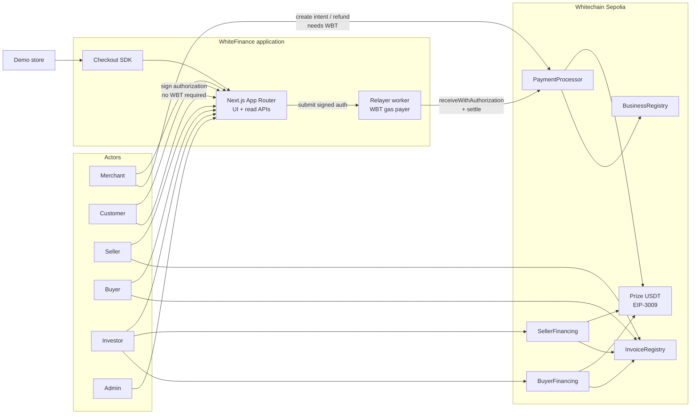
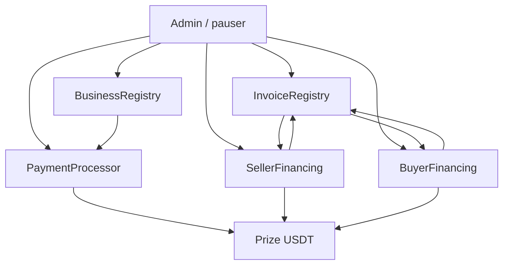

# WhiteFinance architecture

WhiteFinance is a Web3 business finance platform on Whitechain Sepolia. This document is the system design. It does not authorize implementation.

Related documents:

- [Business logic](./business-logic.md)
- [Security model](./security-model.md)
- [API specification](./api-specification.md)
- [Frontend specification](./frontend-specification.md)
- [Development roadmap](./development-roadmap.md)
- [Whitechain compatibility](./whitechain-compatibility.md)

## 1. What the product is

WhiteFinance gives a business three independently working capabilities on one network, one stablecoin, and one application:

1. **Operate** — reusable USDT checkout for merchants: registration, payment links, hosted checkout, receipts, refunds, history, SDK, webhook-ready notifications.
2. **Tokenize** — invoice financing with two separate workflows: seller-side factoring and buyer-side financing.
3. **Scale** — gasless checkout so a customer can pay USDT without holding WBT. The customer still signs an exact EIP-3009 authorization.

The qualifying token is only the official prize USDT:

`0xcedfB56113143d55b2358b8CFbB0dEB5Ad2f55a7`

USDT.e and any self-created token are out of scope.

## 2. Design principles

1. **Chain is the source of truth.** No PostgreSQL, Prisma, Supabase, MongoDB, Firebase, or other database. APIs read contracts and events.
2. **localStorage is never authoritative.** It may hold theme, last wallet, and form drafts.
3. **Do not store private documents or personal data onchain.** Invoice files are synthetic demo documents. Only hashes go onchain.
4. **A document hash is not authenticity.** Buyer confirmation, duplicate checks, and offchain legal agreements are required for the financing story.
5. **Technical enforcement is not legal enforceability.** Contracts move USDT and record state. They do not create a perfected assignment under any jurisdiction.
6. **Customers always authorize exact payments.** Gasless does not mean unsigned.
7. **No arbitrary admin withdrawal.** Admins can pause and recover operationally; they cannot skim escrow or merchant funds.
8. **Avoid extra contracts.** Evaluate modules; keep only those that earn their attack surface.
9. **Do not silently settle major business rules.** Proposed defaults are listed for approval.

## 3. Proposed system context



## 4. Proposed repository layout

Not created in this architecture pass.

```text
WhiteFinance/
  README.md
  docs/
  contracts/                 Foundry: src, test, script
  apps/web/                  Next.js App Router (UI + ordinary APIs)
  apps/relayer/              Minimal long-running worker
  packages/checkout-sdk/     Tiny TypeScript SDK for the demo store
```

One Next.js app serves every role. The demo store is a route group inside the same app (`/demo/store`) that integrates checkout the way an external merchant would, using the SDK. That satisfies “a separate demo app adds in about 20 lines” without a second deployment.

The relayer is a **separate Node process**, not an in-memory Next.js queue pretending to be durable. Its private key never enters the browser or a `NEXT_PUBLIC_` variable.

## 5. Technology stack

| Layer | Choice | Notes |
| --- | --- | --- |
| Contracts | Solidity `^0.8.24`, compiler pin `0.8.30`, `evm_version = prague` | Matches current Whitechain Foundry guide. Older “0.8.19 max” docs are stale. |
| Toolchain | Foundry + OpenZeppelin + SafeERC20 + AccessControl + ReentrancyGuard + Pausable | Windows development uses WSL for `forge`. |
| Frontend | Next.js App Router, TypeScript, Tailwind, shadcn/ui, wagmi, viem, Reown AppKit, RHF, Zod, Recharts, Lucide | AppKit email/social **off**. Embedded wallets are not supported on Whitechain. |
| Backend | Next.js route handlers for reads and intent helpers; viem for chain I/O | No database. |
| Relayer | Minimal Node + TypeScript + viem | Holds `RELAYER_PRIVATE_KEY`. |
| Token | Prize USDT only | 6 decimals. |

No stack substitution is required by the compatibility review. Constraints on how the stack is used are in `docs/whitechain-compatibility.md`.

## 6. Contract architecture

### 6.1 Module decision

| Module | Decision | Reason |
| --- | --- | --- |
| `BusinessRegistry.sol` | **Keep** | Merchant and counterparty identity without a database. |
| `InvoiceRegistry.sol` | **Keep** | Commercial invoice facts, hashes, uniqueness, buyer confirmation. |
| `SellerFinancing.sol` | **Keep** | Seller-side factoring state machine and accounting. |
| `BuyerFinancing.sol` | **Keep** | Buyer-side financing; separate accounting so 30,000 USDT cannot be double-counted. |
| `PaymentProcessor.sol` | **Keep** | Intents, settlement, receipts, refunds, gasless settle. |
| `EscrowVault.sol` | **Keep (implementation brief)** | Financing USDT custody with fixed beneficiaries, double-release protection, and no admin withdrawal. Operate checkout does not use the vault. |
| `TransferPolicy.sol` | **Omit in v1** | Prize USDT already has a blocklist. Financing positions are non-transferable. No ERC-721/1155. Transfer restrictions live in the financing contracts. |

The architecture originally proposed omitting `EscrowVault`. The smart-contract implementation brief required it, so v1 includes it for Tokenize flows only. `TransferPolicy` stays omitted. See `docs/contracts.md`.

### 6.2 Responsibilities

#### BusinessRegistry

Stores public business profiles keyed by wallet.

Fields (no PII):

- `account` (address)
- `displayName` (short string; demo names only)
- `roles` bitmask: `MERCHANT`, `SELLER`, `BUYER`, `INVESTOR`
- `payoutAddress` (where Operate settlements are sent; defaults to `account`)
- `active` bool
- `webhookUrl` optional public HTTPS URL (see honesty note below)
- `createdAt`, `updatedAt`

Functions:

- `register(displayName, roles, payoutAddress, webhookUrl)`
- `updateProfile(...)` by owner
- `setActive(account, bool)` by admin (abuse freeze, not a funds grab)

Events: `BusinessRegistered`, `BusinessUpdated`, `BusinessStatusChanged`.

Honesty note: a webhook URL onchain is public. That is the cost of a database-free MVP. No webhook signing secret is stored onchain. The relayer/worker signs webhook bodies with a server-only key.

#### InvoiceRegistry

Stores the commercial invoice, not the financing position.

Fields:

- `invoiceId`
- `seller`, `buyer`
- `invoiceNumber` (bytes32 hash of the seller’s reference)
- `faceValue` (USDT base units, 6 decimals)
- `dueDate` (unix seconds)
- `documentHash` (keccak256 of synthetic demo bytes)
- `termsHash` (keccak256 of a synthetic assignment/financing terms file)
- `status`: `CREATED`, `BUYER_CONFIRMED`, `CANCELLED`, `SETTLED`
- `sellerFinancingId` (0 if none)
- `buyerFinancingId` (0 if none)

Uniqueness: `(seller, invoiceNumber)` is unique. Optional second uniqueness on `documentHash` so the same PDF cannot back two invoices.

Functions:

- `createInvoice(...)` seller only
- `confirmInvoice(invoiceId)` buyer only
- `cancelInvoice(invoiceId)` seller, only before financing is funded
- registry callbacks from financing contracts to attach IDs and mark `SETTLED`

Events: `InvoiceCreated`, `InvoiceConfirmed`, `InvoiceCancelled`, `InvoiceSettled`, `FinancingAttached`.

#### PaymentProcessor

Source of truth for Operate.

Intent fields:

- `intentId`
- `merchant`
- `payoutAddress` (snapshot from registry at creation)
- `orderRef` (bytes32, unique per merchant)
- `amount`
- `token` (immutable prize USDT)
- `payer` (zero = any wallet may pay)
- `expiresAt`
- `status`: `CREATED`, `SETTLED`, `PARTIALLY_REFUNDED`, `REFUNDED`, `EXPIRED`, `CANCELLED`
- `paidAmount`, `refundedAmount`
- `payerSettled` (actual payer)
- `settlementTx` recorded offchain from the receipt; onchain stores `settledBlock`

Functions:

- `createIntent(orderRef, amount, payer, expiresAt)` merchant
- `cancelIntent(intentId)` merchant, only `CREATED`
- `expireIntent(intentId)` permissionless after expiry
- `pay(intentId)` customer with WBT; `transferFrom` after onchain approve, or combined if already approved
- `settleWithAuthorization(intentId, auth)` gasless path; permissionless to submit, economically used by the relayer
- `refund(intentId, amount)` merchant; pulls USDT from merchant to original payer

`settleWithAuthorization` sequence inside one transaction:

1. Check intent is `CREATED`, not expired, token is prize USDT, `auth.value == amount`, `auth.from` matches `payer` if set, `auth.to == address(this)`, time window valid, nonce unused (token will also check).
2. Mark intent `SETTLED` (effects before external calls where possible; if the token call fails the whole tx reverts).
3. Call USDT `receiveWithAuthorization`.
4. `safeTransfer` USDT to `payoutAddress`.
5. Emit `PaymentSettled`.

This uses `ReceiveWithAuthorization`, not `TransferWithAuthorization`, so only `PaymentProcessor` can execute the signed transfer.

Events: `PaymentIntentCreated`, `PaymentSettled`, `PaymentRefunded`, `PaymentCancelled`, `PaymentExpired`.

Receipts are these events plus explorer links. There is no NFT receipt in v1.

#### SellerFinancing

One investor, all-or-nothing, non-transferable.

See state machine and accounting in `docs/business-logic.md`.

Core functions:

- `requestFinancing(invoiceId, advanceAmount, discountAmount)` seller
- `cancelRequest(financingId)` seller, before fund
- `fund(financingId)` investor; pulls `advanceAmount` USDT from investor, sends to seller, records investor as assignee
- `repay(financingId)` buyer (or anyone paying on behalf of buyer); pulls remaining face (or recorded repayment amount) and sends to investor
- permissionless `markExpired`, `markOverdue`, `markDefaulted` based on timestamps
- `raiseDispute` / `resolveDispute` (resolution policy is an open decision)

Invariant: an invoice cannot have two active seller financings, and advance cannot exceed remaining allocatable face.

#### BuyerFinancing

Separate contract, separate IDs, separate events.

- `requestFinancing(invoiceId, principal, fee)` buyer or seller on buyer’s behalf — **open decision who may request**
- `fund(financingId)` investor pays `principal` to seller, not to buyer
- `repay(financingId)` buyer pays `principal + fee` to investor
- seller remainder (`faceValue - principal`) is never assigned to the investor

Invariant: `principal + sellerRemainder == faceValue`. Investor receivable is `principal + fee`, not a second copy of `principal` on the seller side.

### 6.3 Contract graph



`PaymentProcessor` reads `BusinessRegistry` for merchant active flag and payout address.

Financing contracts read and lock rows on `InvoiceRegistry`. They do not call `PaymentProcessor`. Operate and Tokenize share the token and the identity registry, not a single god-contract.

### 6.4 Access control (summary)

Full matrix: `docs/security-model.md`.

| Role | Contracts | Power |
| --- | --- | --- |
| `DEFAULT_ADMIN_ROLE` | all | Grant/revoke roles, set prize token address only at deploy or via tightly constrained setter |
| `PAUSER_ROLE` | all pauseable modules | Pause/unpause |
| Registered merchant | registry + processor | Create/cancel intents, refund |
| Registered seller / buyer | invoice + financing | Create/confirm invoices, request financing |
| Any investor address (proposed: open after registry) | financing | Fund all-or-nothing |
| Relayer EOA | none onchain | Pays WBT; may call `settleWithAuthorization` like anyone else |
| Token owner of prize USDT | USDT, not WhiteFinance | Mint, block, upgrade USDT |

No role can `withdraw(token, to, amount)` from protocol balances except through the documented refund, payout, and repayment paths.

### 6.5 Why not ERC-721

v1 financing positions are non-transferable. An NFT would imply transfer, marketplaces, and approval races without improving settlement. Invoice identity is a `uint256` plus events. Revisit only if a later version needs secondary-market notes.

## 7. Backend architecture

### 7.1 Two processes

| Process | Duty | Durability |
| --- | --- | --- |
| Next.js | Host UI, read APIs, create-intent helpers that encode tx data, webhook **signature verification docs**, SDK routes | Stateless. Restarts lose nothing authoritative. |
| Relayer worker | Validate EIP-3009 payload, submit `settleWithAuthorization`, enforce gas budget, pause switch, rate limits | Private key and in-memory nonce. **Not durable.** On restart, `eth_getTransactionCount` rebuilds nonce. In-flight txs may need client retry. |

Do not describe an in-memory array as a job queue. If a webhook POST fails after three attempts, it is dropped. The merchant polls. The chain still has the payment.

### 7.2 Read path

APIs use viem:

- `readContract` for current state
- `getLogs` / `getContractEvents` from a configured `DEPLOYMENT_BLOCK`
- receipt inspection for a user-supplied tx hash

Because there is no indexer database, list endpoints are bounded (latest N events, or events for a given address). This is an accepted MVP limitation.

### 7.3 Write path

Browsers send transactions for connected wallets (merchants, sellers, buyers, investors, WBT-paying customers).

The relayer sends only:

`PaymentProcessor.settleWithAuthorization(intentId, authorization)`

### 7.4 Relayer validation checklist

Before sending a transaction, the relayer checks:

1. Signature recovers to `auth.from`
2. EIP-712 domain matches onchain `DOMAIN_SEPARATOR`
3. Typehash is `ReceiveWithAuthorization` (not a raw permit, not `TransferWithAuthorization`)
4. `auth.to == PaymentProcessor`
5. `auth.value` equals intent amount
6. Token is prize USDT
7. Intent exists, status `CREATED`, not expired
8. `auth.from` matches intent.payer if payer was bound
9. `validAfter` / `validBefore` against current timestamp with the token’s exclusive inequalities
10. `authorizationState(from, nonce) == false`
11. `from` and processor are not `isBlocked`
12. Customer USDT balance >= amount
13. Relayer WBT balance and gas budget remaining
14. Per-payer and per-IP rate limits
15. Global pause flag

The contract repeats the value/recipient/status checks. Relayer checks save gas and stop drain attacks.

### 7.5 Confirmation and reorgs

Indexer loop (worker or on-demand API):

1. On receipt success, store nothing durable; return `txHash`, `blockNumber`, `stage: soft`.
2. When serving payment status, compare `settledBlock` to current `latest`, `safe`, and `finalized` heads if those tags work on the RPC.
3. If a previously seen log is absent after a reorg (head moved below `settledBlock` and the log is gone), API returns `REORGED` / `PENDING` until it reappears or the intent is unpaid again.

On OP Stack, deep L2 reorgs after `safe` are uncommon but soft confirmations can disappear. The UI must allow that state.

Idempotency:

- Intent IDs and `orderRef` uniqueness prevent double capture.
- Token authorization nonces prevent double EIP-3009 execution.
- Relayer `Idempotency-Key` header prevents duplicate submissions for the same signed payload in a short window (in-memory only).

### 7.6 Webhooks

“Webhook-ready” means:

- Event payload schema is stable (`docs/api-specification.md`).
- Worker can POST after `PaymentSettled` / `PaymentRefunded`.
- Body is HMAC-signed with `WEBHOOK_SIGNING_SECRET`.
- Merchant verifies the signature and then **re-reads the payment from the API or chain**.

It does not mean at-least-once durable delivery.

### 7.7 Error handling and rate limits

API errors are typed: `CHAIN_UNAVAILABLE`, `INTENT_NOT_FOUND`, `INTENT_EXPIRED`, `AUTH_INVALID`, `AUTH_EXPIRED`, `INSUFFICIENT_USDT`, `PAYER_BLOCKED`, `RELAYER_PAUSED`, `GAS_BUDGET_EXCEEDED`, `RATE_LIMITED`, `REORGED`.

Rate limits (proposed; needs approval):

- Relayer: 30 settlements / minute globally, 10 / minute / payer, 60 / minute / IP
- Read APIs: 120 / minute / IP
- Respect upstream RPC `429`

### 7.8 Environment variables

See `docs/api-specification.md`. Secrets: `RELAYER_PRIVATE_KEY`, `WEBHOOK_SIGNING_SECRET`, optional `ADMIN_PRIVATE_KEY` only for scripts, never the browser. Public: chain ID, RPC, prize USDT, contract addresses, Reown project id.

### 7.9 Logging

Log intent id, tx hash, payer, amount, error code. Do not log raw private keys, seed phrases, or full signed authorizations in production-like demo mode beyond what is needed to debug a failed relay (authorization already public once submitted).

## 8. Frontend architecture

Six experiences, one app, role-aware navigation. Pages and states: `docs/frontend-specification.md`.

Visual direction: dark terminal-inspired fintech, restrained orange accent, tabular figures, useful charts, responsive.

Wallet: Reown AppKit locked to Whitechain Sepolia. Wrong-network screen if the wallet is elsewhere.

## 9. End-to-end journeys (short)

Full accounting: `docs/business-logic.md`.

### 9.1 Operate — customer pays at hosted checkout

1. Merchant registers onchain.
2. Merchant creates a payment intent (WBT gas) with order reference `INV-1042` and amount `25.00` USDT.
3. WhiteFinance returns a link `/pay/{intentId}`.
4. Customer opens the link, connects a wallet, sees merchant, amount, token, destination, expiry.
5. **Gas path:** customer approves USDT if needed and calls `pay`. Customer pays WBT.
6. **Gasless path:** customer signs `ReceiveWithAuthorization` for exact token, amount, recipient (`PaymentProcessor`), nonce, and validity. Relayer submits and pays WBT.
7. Contract moves USDT to the merchant payout address and emits `PaymentSettled`.
8. Customer sees a receipt with explorer link. Merchant dashboard shows the payment. Optional webhook fires.

### 9.2 Operate — refund

Merchant clicks refund (full or partial). Merchant must hold enough USDT and WBT. Processor pulls USDT from merchant to original payer and emits `PaymentRefunded`. Refunded total cannot exceed paid amount.

### 9.3 Tokenize — seller factoring

Invoice `100,000` USDT due in 60 days. Investor advances `95,000` USDT. Buyer later pays `100,000` USDT to the investor via the contract.

### 9.4 Tokenize — buyer financing

Invoice `100,000` USDT. Investor pays `30,000` USDT to the seller. Buyer later pays `30,000 + fee` to the investor. Seller remains owed `70,000`. The `30,000` is not counted twice.

### 9.5 Scale — gasless only for checkout

Financing `fund` and `repay` require the actor to hold WBT in v1. Refunds require merchant WBT. That is intentional: Scale is demonstrated on Operate checkout.

## 10. SDK integration target

The demo store should add checkout in a small, copy-pasteable module:

```ts
import { createWhiteFinanceCheckout } from "@whitefinance/checkout-sdk";

const wf = createWhiteFinanceCheckout({
  apiBase: process.env.NEXT_PUBLIC_WF_API_BASE!,
  merchant: "0x...",
});

const { checkoutUrl } = await wf.createPayment({
  orderRef: order.id,
  amount: "25.00",
  onPaid: "/orders/thank-you",
});

redirect(checkoutUrl);
```

The SDK talks to WhiteFinance APIs, which prepare the onchain `createIntent` transaction for the merchant wallet **or**, for the demo, use a merchant session already connected. Exact merchant-auth for a headless API without a database is an open decision (wallet signature per request is the proposed default).

A plain `transfer` button is not an acceptable implementation of this SDK.

## 11. Risks

| Risk | Severity | Mitigation |
| --- | --- | --- |
| Prize USDT upgrade or blocklist | High | Capability checks; pause; never cache ABI forever |
| Relayer key leak or gas drain | High | Isolated key, budget, pause, rate limits, no browser exposure |
| Soft confirmation treated as final | High | Explicit stages in UI/API |
| Duplicate invoice financing | High | Registry locks; mutually exclusive workflows (proposed) |
| Hash treated as authenticity | High | Product copy + buyer confirm + legal disclaimer |
| Database-free webhook loss | Medium | Polling is source of truth |
| Public RPC 429 | Medium | Batch, backoff, optional Ankr |
| Reown embedded wallet failure | Medium | Disabled; Scale story is gasless EOA |
| No known prize-USDT faucet | High operational | Open decision |
| Admin EOA on testnet | Medium | Documented trust; pause only |
| Windows Foundry | Low | WSL |
| Off-platform buyer payment to seller after assignment | High legal / medium technical | Repayment address enforced onchain; legal notice still required |

## 12. Assumptions

1. Demo users can obtain prize USDT somehow during the event even though a faucet was not found in docs.
2. All demo businesses are synthetic. No real KYC, no real invoices.
3. Testnet WBT and USDT have no monetary value.
4. v1 is single-chain, single-token.
5. One Next.js deployment is enough for UI, read API, and demo store.
6. `safe` / `finalized` tags will work; if not, the product degrades to block-depth heuristics and says so.

## 13. Missing requirements, contradictions, open decisions

See the same list in `README.md`. Major items that must not be silently decided:

1. Omit `EscrowVault` and `TransferPolicy` in v1?
2. Mutually exclusive seller vs buyer financing on one invoice?
3. Onchain payment intents vs signed offchain intent blobs?
4. Public webhook URLs onchain vs poll-only?
5. Platform fee: proposed `0`.
6. Late interest: proposed none.
7. Grace period `OVERDUE` → `DEFAULTED`: proposed 14 days, permissionless mark.
8. Who may request buyer financing: buyer only, or seller too?
9. Who may fund: any registered investor, or allowlist?
10. Seller factoring: full face only, or partial advance?
11. Buyer financing fee: fixed USDT amount vs percentage.
12. Dispute resolver: both parties, admin, or both?
13. Relayer settlement function permissionless vs `RELAYER_ROLE`.
14. Merchant-funded refunds vs escrowed capture.
15. Soft-pay UX vs waiting for `safe`.
16. Recurring / subscriptions: prize text mentions them; this brief does not. Proposed **out of scope**.
17. How demo wallets receive prize USDT.
18. Admin as EOA vs Safe on testnet.
19. Headless API auth for external merchants without a database.
20. Whether a keeper is needed, or all time transitions are permissionless.

## 14. Proposed implementation order

Exact order, also in `docs/development-roadmap.md`:

1. Preflight: re-verify token domain separator, `receiveWithAuthorization` with a dry-run, RPC `safe`/`finalized` tags, Foundry on WSL.
2. Foundry scaffold, interfaces for prize USDT, fork/mainnet-style tests against Sepolia RPC as forked tests if feasible.
3. `BusinessRegistry` + tests.
4. `PaymentProcessor` (WBT path) + tests: intents, pay, refunds, events, uniqueness.
5. Frontend: merchant + customer hosted checkout + receipts (Operate, gasful).
6. Checkout SDK + demo store route.
7. Relayer + gasless `receiveWithAuthorization` path (Scale).
8. `InvoiceRegistry` + `SellerFinancing` + tests (Tokenize seller).
9. `BuyerFinancing` + tests and accounting invariants (Tokenize buyer).
10. Frontend: seller, buyer, investor, admin.
11. Webhook worker (best-effort), pause/runbooks, confirmation stages.
12. Verify contracts, qualifying USDT payment, README explorer link, demo video, `WHITECHAIN_FEEDBACK.md`.

Stop after architecture until these documents are approved.
