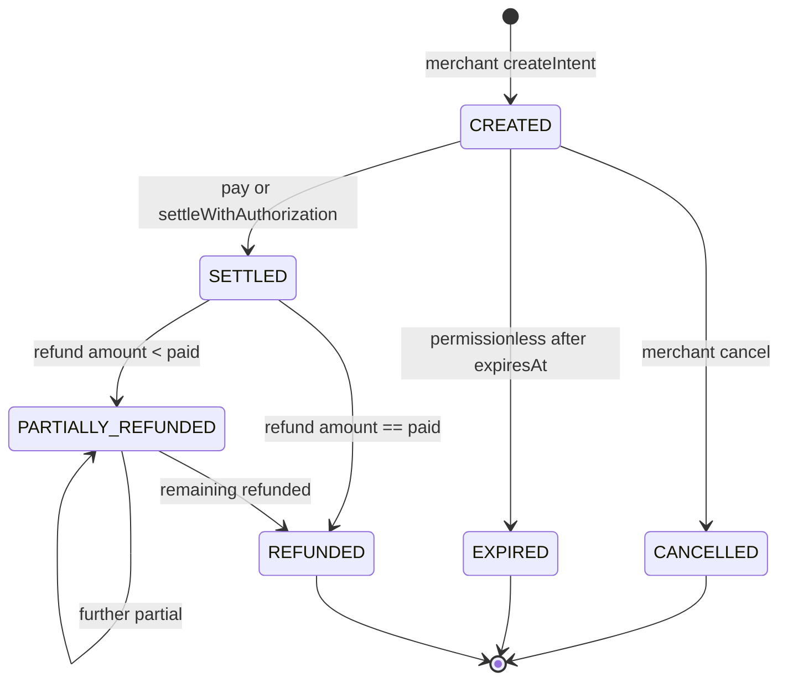
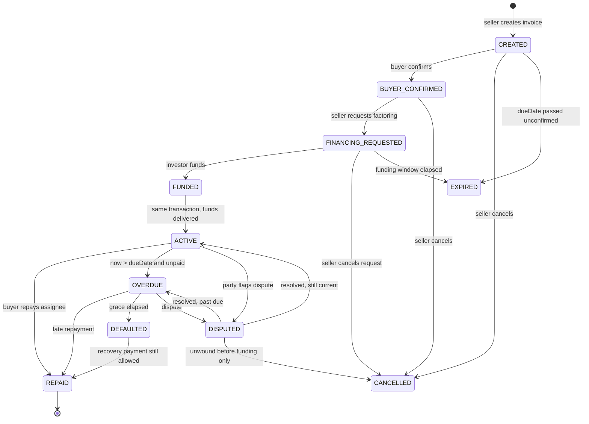
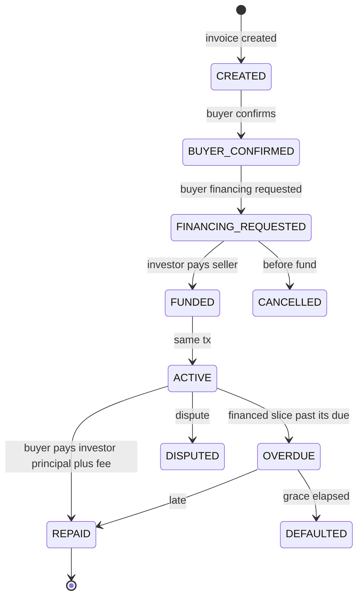

# WhiteFinance business logic

This document explains every major flow in plain language, with numbers, state machines, and the line between software and law.

Amounts use USDT with 6 decimals. `100,000` USDT is `100_000_000000` base units. Examples use human units unless noted.

## 1. Actors

| Actor | Goal in the demo |
| --- | --- |
| Merchant | Get paid for an order, refund if needed, see history |
| Customer | Pay a specific order, get a receipt |
| Seller | Issue an invoice, optionally sell the receivable early |
| Buyer | Confirm the invoice is real, pay at maturity or use buyer financing |
| Investor | Advance USDT, earn the agreed discount or fee |
| Administrator | Pause, freeze abusive accounts, resolve configured disputes |
| Relayer | Pay WBT so a customer can pay without holding WBT |

A wallet may hold several roles. A company can be merchant and seller. The registry records roles; contracts still check `msg.sender` on each action.

## 2. Operate — business payments

### 2.1 Why this is not a transfer button

A raw `USDT.transfer(merchant, amount)` does not give:

- a unique order reference
- an expiry
- a bound payer (optional)
- a single settlement event a merchant can reconcile
- partial/full refunds against that order
- a hosted checkout a third-party store can open
- a gasless path that still names the exact payment

WhiteFinance therefore uses a **payment intent** as a first-class onchain object.

### 2.2 Intent lifecycle



There is no `FAILED` state. A failed transaction leaves the intent `CREATED`.

### 2.3 Example: 25.00 USDT checkout

Merchant “Northwind Tools” is registered. Payout address is the merchant wallet.

1. Merchant creates intent:
   - `orderRef` = `PO-1042`
   - `amount` = `25.000000` USDT
   - `payer` = `0x0` (anyone)
   - `expiresAt` = now + 30 minutes
2. Customer has `80` USDT. They do not need WBT if they use gasless checkout.
3. Customer signs (gasless) or sends (gasful) a payment of exactly `25` USDT.
4. `PaymentProcessor` receives `25` USDT and forwards `25` USDT to the merchant.
5. Balances:
   - Customer: `80 - 25 = 55`
   - Merchant: `+25`
   - Processor: `0` (must not retain a remainder)

If the merchant later refunds `10`:

- Merchant must hold at least `10` USDT.
- Customer: `55 + 10 = 65`
- Merchant: `25 - 10 = 15`
- Intent: `paidAmount = 25`, `refundedAmount = 10`, status `PARTIALLY_REFUNDED`

A second refund of `15` sets status `REFUNDED`. A third refund reverts: `refundedAmount + x <= paidAmount`.

Platform fee proposed: **0**. If a fee is added later, it must be taken in the same settlement transaction and appear in `PaymentSettled`.

### 2.4 Unique order references

`(merchant, orderRef)` is unique. Retrying `createIntent` with the same reference reverts. The store can reuse a reference only after a different merchant, never to capture twice.

`intentId` is a contract counter or hash of `(merchant, orderRef, chainId)`. Either is acceptable; proposed: incrementing `uint256` plus the merchant’s `orderRef` for humans.

### 2.5 Gasful pay

Customer path when they hold WBT:

1. If `allowance(customer, processor) < amount`, customer `approve`s (or `permit`s).
2. Customer calls `pay(intentId)`.
3. Processor `transferFrom`s customer → processor, then processor → merchant, or `transferFrom` customer → merchant if we snapshot payout and pull once.

**Proposed:** pull once `transferFrom(customer, payoutAddress, amount)` after checks, so the processor never holds funds on the happy path. Then `receiveWithAuthorization` is the exception: those funds **must** arrive at the processor because `to == msg.sender`.

So:

- Gasful: `transferFrom(payer, payoutAddress, amount)` — processor never holds.
- Gasless: `receiveWithAuthorization` to processor, then `transfer` to payout.

### 2.6 Gasless pay (Scale)

Plain language:

The customer is not sending a blockchain transaction. They are signing a structured message that says: “I, this wallet, allow this exact USDT amount to move to the WhiteFinance processor, after this time, before this time, with this one-time nonce.” The relayer wraps that message in a transaction and pays WBT. The token contract checks the signature. The processor checks it is the right order. Only then do tokens move.

The customer can refuse to sign. Nobody can pay from their wallet without that signature.

See section 6 for the authorization fields.

### 2.7 What Operate does not do in v1

- Subscriptions / recurring pulls (prize text mentions them; this brief does not)
- Split payments, tips, FX
- Custodial balances or “WhiteFinance account balance”
- Chargebacks (refunds are merchant-initiated)
- Escrowed capture (`authorize` then `capture` later)

## 3. Invoice authenticity and law

### 3.1 A hash is not a real invoice

`documentHash = keccak256(demoPdfBytes)` proves only that someone once had those bytes. It does not prove:

- the seller actually delivered goods
- the buyer actually owes the money
- the invoice number is unique in the real world
- the PDF was not generated solely to raise financing
- the receivable is unencumbered

WhiteFinance therefore requires **buyer confirmation** before financing can be requested (seller lifecycle) and treats documents as synthetic demo files.

### 3.2 Controls that are technical, not legal

| Control | What it actually does | What it does not do |
| --- | --- | --- |
| Buyer `confirmInvoice` | Buyer’s wallet signed an onchain “I acknowledge this invoice” | Court-admissible notice in every jurisdiction; identity of the legal entity |
| `documentHash` | Tamper evidence for the demo file | Authenticity, originality, or “this is the invoice the ERP issued” |
| Duplicate `(seller, invoiceNumber)` | Stops the same seller minting two protocol invoices with one number | Stops the seller financing the same real-world invoice on another platform |
| Duplicate `documentHash` | Stops re-uploading the same demo bytes | Cross-protocol duplicate financing |
| Assignee recorded onchain | Protocol repayment goes to the investor | Legal assignment of the receivable; debtor protection rules |
| Non-transferable position | Investor cannot sell the protocol position | Investor cannot sell the legal claim offchain |

### 3.3 Assignment and notification

In many legal systems a buyer who pays the original seller in good faith, without notice of assignment, is discharged. Software cannot fully solve that.

Demo design:

1. Buyer confirms the invoice **before** financing.
2. On funding, the contract emits `ReceivableAssigned(invoiceId, investor, amount)` and the UI tells the buyer: “Pay the protocol / investor, not the seller.”
3. `repay` on the financing contract pays the investor. Paying the seller’s wallet off-protocol is invisible to WhiteFinance.

A real product would add a receivables purchase agreement, KYC, and often a notice of assignment under the governing law. Those are **outside the blockchain** and out of v1 scope except as demo PDFs whose hashes are stored.

### 3.4 Copy the product must show

Every financing screen includes a short notice:

> Onchain state records who paid whom in USDT. It does not prove the invoice is authentic and does not replace a legal assignment, notice to the debtor, or a financing agreement.

## 4. Seller-side financing (factoring)

### 4.1 Story

Northwind has an invoice: buyer Apex owes **100,000 USDT** in 60 days. Northwind needs cash now. River Capital agrees to advance **95,000 USDT** and collect **100,000 USDT** from Apex at maturity. River’s gross profit is **5,000 USDT** if Apex pays in full on time.

This is a sale of a receivable at a discount, not a loan against the seller’s general credit, in product language. Legal characterization still depends on offchain documents.

### 4.2 State machine



`FUNDED` and `ACTIVE` are distinct in the brief. Proposed implementation: they occur in **one transaction**. `FUNDED` is emitted then status stored as `ACTIVE`. If approval prefers a two-step “funds in contract then release,” that would require `EscrowVault` and is a change request.

### 4.3 Accounting — happy path

All figures USDT.

| Step | Seller | Buyer | Investor | Protocol |
| --- | --- | --- | --- | --- |
| Start | 0 | 100,000 cash (will pay later) | 95,000 cash | 0 |
| Fund | +95,000 | 0 movement | −95,000 | 0 |
| Repay at maturity | 0 movement | −100,000 | +100,000 | 0 |
| **End** | **+95,000 cash, receivable gone** | **−100,000** | **+5,000 profit** | **0** |

Checks:

- Seller did not also remain owed 100,000 inside the protocol.
- Investor is the only protocol assignee for this invoice’s seller-financed face.
- Protocol USDT balance returns to 0.

Discount `5,000 = faceValue - advanceAmount`. Proposed: both `advanceAmount` and `discountAmount` are explicit parameters and must satisfy `advance + discount == repayableFace` for v1 full-face factoring.

### 4.4 Partial factoring (proposed, needs approval)

If allowed, seller may factor `60,000` of a `100,000` invoice at a `3,000` discount (`advance = 57,000`). Remaining seller claim `40,000`. Over-allocation is `advance + remaining + any buyer-financed principal <= faceValue` with no overlap.

If rejected, v1 seller factoring is always the full face.

### 4.5 Duplicate and over-allocation guards

`InvoiceRegistry` stores at most one `sellerFinancingId` for a live request/position.

`requestFinancing` reverts if:

- invoice not `BUYER_CONFIRMED`
- `sellerFinancingId != 0`
- `buyerFinancingId != 0` **if mutually exclusive (proposed)**
- `advanceAmount == 0` or `advanceAmount + discount != face` (if full-face)
- `advanceAmount > faceValue`

`fund` reverts if another investor already funded (all-or-nothing, first success wins). There is no partial fill book.

### 4.6 Default path

If unpaid at `dueDate`, anyone may call `markOverdue`. After a grace period (proposed 14 days) anyone may call `markDefaulted`. Repayment remains possible; status becomes `REPAID` from `DEFAULTED` if money arrives. No extra default interest in v1 (proposed).

Default does **not** let admin seize unrelated funds.

### 4.7 Dispute path

Dispute is a flag that **stops repayment routing changes** and **stops new funding**. It cannot claw back the 95,000 already sent to the seller. That limitation must be visible in the UI.

Unwinding a funded factoring position is a legal problem, not a `withdraw()` function.

## 5. Buyer-side financing

### 5.1 Story

Apex must pay Northwind 100,000 USDT but only wants to pay 30,000 now with help from River Capital.

- River pays **30,000 USDT to Northwind** (not to Apex).
- Apex still owes Northwind **70,000**.
- Apex owes River **30,000 + fee**.

If the fee is **1,500** (example 5% of principal, **fee model needs approval**):

Apex’s total cash outflow over time = `70,000 + 31,500 = 101,500`.

Northwind’s total inflow = `30,000 (from investor) + 70,000 (from buyer) = 100,000`.

River’s profit = `1,500` if Apex repays the financed slice.

### 5.2 The double-count rule

Illegal mental model:

- Seller is owed 100,000 **and**
- Investor is owed 30,000
- Total claims 130,000 against a 100,000 invoice

Legal mental model:

| Claim | Debtor | Creditor | Amount |
| --- | --- | --- | --- |
| Unfinanced remainder | Buyer | Seller | 70,000 |
| Financed principal + fee | Buyer | Investor | 31,500 |
| **Sum of claims on the buyer** | | | **101,500** |
| **Seller’s remaining invoice claim** | | | **70,000** |

The 30,000 that the investor paid the seller **extinguishes** 30,000 of the seller’s invoice. It becomes a buyer–investor receivable.

Protocol invariant:

```text
sellerRemaining + investorPrincipal == faceValue
investorReceivable == investorPrincipal + fee
sellerRemaining + investorReceivable == faceValue + fee
```

### 5.3 State machine

Independent from seller factoring. Same names, different contract.



Repayment of the **70,000 remainder** can happen:

- off-protocol (buyer pays seller directly), which the protocol cannot see, or
- via a proposed `paySellerRemainder(invoiceId)` helper on `InvoiceRegistry` / `BuyerFinancing` that records `sellerRemainderPaid`

**Needs approval:** whether v1 tracks the 70,000 onchain or only the financed 30,000.

**Proposal:** track both with two buckets on the invoice:

- `financedPaidToInvestor`
- `remainderPaidToSeller`

Invoice `SETTLED` only when both buckets are full (remainder may be marked paid by seller acknowledgment if paid offchain — that is another decision; default: remainder paid through the contract so the demo is complete).

### 5.4 Funding transaction

`fund` on `BuyerFinancing`:

1. Checks request is open, invoice confirmed, no conflicting seller financing (if exclusive).
2. `transferFrom(investor, seller, principal)` — **never to the buyer**.
3. Records `investor`, sets `ACTIVE`.
4. Emits `BuyerFinancingFunded(invoiceId, investor, principal, fee, seller)`.

Accounting after fund:

- Seller: +30,000, remaining claim 70,000
- Buyer: still holds their cash; debt 70,000 to seller + 31,500 to investor
- Investor: −30,000 cash, +31,500 receivable

### 5.5 Repayment transaction

`repay` pulls `principal + fee` from buyer to investor. It does not send anything to the seller.

A separate `payRemainder` pulls `sellerRemaining` from buyer to seller.

Order does not matter. Neither function should increase the other bucket.

### 5.6 Combined example timeline

Day 0: invoice 100,000 created, buyer confirms.

Day 1: buyer financing funded, 30,000 seller received.

Day 2: buyer pays 70,000 remainder to seller through the contract. Seller is fully paid. Investor still owed 31,500. Invoice not fully settled until investor is paid.

Day 60: buyer pays 31,500 to investor. Invoice settled.

If instead the buyer paid 100,000 to the seller on day 2, the investor would be unpaid and the seller would have been overpaid by 30,000. The protocol cannot fix an offchain overpayment. The demo UI must route the remainder and the investor repayment through the contract.

## 6. Gasless authorization fields

Customer reviews and signs:

| Field | Example | Why |
| --- | --- | --- |
| Token | Prize USDT | Wrong token would not qualify and would not settle |
| from | Customer wallet | Payer |
| to | `PaymentProcessor` | Required for `receiveWithAuthorization` |
| value | `25000000` (25 USDT) | Exact amount |
| validAfter | `0` or now−1 | Not valid too early |
| validBefore | now + 10 minutes | Short window |
| nonce | random `bytes32` | Replay protection |
| chainId | `1874` | Domain separator |
| verifyingContract | Prize USDT | Domain separator |

The hosted checkout must show these in human language before `eth_signTypedData_v4`.

It must never imply:

- “We will bill your wallet later without a signature”
- “Gasless means no approval”
- “The relayer can change the amount”

Permit (EIP-2612) is **not** the v1 checkout path. A permit for a large allowance would let the processor pull more later. EIP-3009 is exact.

## 7. Relayer economics (product view)

The business, not the customer, pays gas.

- Relayer EOA is funded with test WBT from the faucet.
- Each gasless checkout burns WBT.
- Spending limits stop a flood of authorizations from draining WBT.
- Pause stops new relays; in-flight txs may still land.

The customer still “pays” in the only way that matters for USDT: they authorize the exact token transfer.

## 8. Time and overdue behaviour

All timestamps are unix seconds on Whitechain L2. 1-second blocks. Do not use L1 time.

Permissionless marking of `EXPIRED` / `OVERDUE` / `DEFAULTED` avoids a privileged keeper. Any caller pays WBT to update state. The UI can also show computed status from timestamps even before someone sends the tx (“overdue on-chain state not yet flipped”).

Proposal: UI uses **computed** status; the write is optional for reporting cleanliness.

## 9. Cancellation rules

| Object | Who | When |
| --- | --- | --- |
| Payment intent | Merchant | `CREATED` only |
| Invoice | Seller | Before any financing is `FUNDED` |
| Seller financing request | Seller | Before `FUNDED` |
| Buyer financing request | Requester | Before `FUNDED` |
| EIP-3009 authorization | Customer | `cancelAuthorization` on USDT if unused |

After funding, cancellation is a legal unwind, not a Solidity `cancel`.

## 10. Demo documents

Repository will later include:

- `demo/invoices/northwind-apex-100000.md` (synthetic)
- `demo/terms/factoring-assignment.md` (synthetic)

Onchain: `keccak256(bytes of file)`. No uploads, no IPFS requirement in v1, no personal data.

## 11. Out of scope unless approved

- Recurring billing
- Multi-investor / order-book funding
- Transferable notes, ERC-20 receipt tokens, NFTs
- Interest compounding, late penalties
- Credit scoring
- Real KYC / sanctions screening beyond USDT’s own blocklist
- Cross-chain messaging
- Escrow of Operate funds
- Paying financing gaslessly
